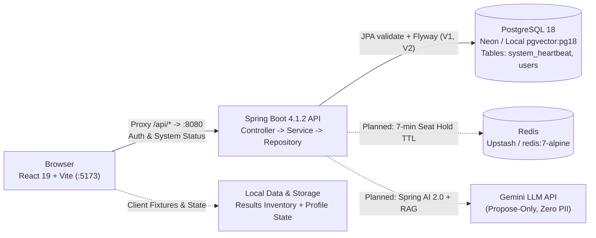

# One Go Bus

**West Bengal AI Smart Bus Booking Platform** — a full-stack monorepo pairing a React 19 + TypeScript + Tailwind CSS v4 web application with a Spring Boot 4.1 (Java 25) REST API, PostgreSQL + Flyway persistence, and planned Spring AI 2.0 + Redis seat-hold infrastructure.

> **Current Implementation Status (Verified in Code)**
> - **Working end-to-end today:** JWT + `HttpOnly` cookie authentication (`POST /api/v1/auth/register`, `/login`, `/logout` backed by PostgreSQL + Flyway `V2__create_users_table.sql`) and live system health telemetry (`GET /api/v1/system/status` backed by `V1__init_health_check.sql`).
> - **Implemented as interactive UI prototypes:** Home search experience (`/`), search results with live `Asia/Kolkata` 90-day date strip, filters, sorting, perforated ticket cards (`/results`), dual-deck seat selection & 7-minute hold timer modal, traveler profile edits (`/profile` persisted in `localStorage`), and conversational UI (`/ask-ai` using client-side simulated replies).
> - **Planned / not yet wired in backend code:** PostgreSQL bus route/trip/booking schemas and APIs, Upstash Redis 7-minute atomic seat locks, payment checkout, and Spring AI 2.0 + `pgvector` + Gemini integration.

<!-- TODO: Add verified application screenshots to docs/screenshots/ (e.g., home.png, results.png, seats.png, profile.png) and link them here -->

---

## 1. Why One Go Bus Exists

Intercity bus travel across West Bengal corridors (such as Kolkata, Siliguri, Digha, Durgapur, Asansol, Malda, and Santiniketan) commonly suffers from fragmented operator schedules, unclear boarding/dropping points, and timed-out seat holds during checkout. One Go Bus aims to solve this for everyday regional travelers and students by combining:

- **Clear route discovery and filtering:** Quick corridor search, rolling 90-day `Asia/Kolkata` date pricing strip, and clean perforated boarding-pass comparison cards.
- **Visual deck & berth clarity:** Interactive Lower/Upper deck seat map showing available, selected, booked, and women-reserved seats alongside a transparent countdown hold timer.
- **Planned conversational AI guidance:** Natural-language trip recommendations and route Q&A constrained strictly to read/propose-only tool calling once backend AI services are wired.

<!-- TODO: Link user research notes, SRS, and System Architecture Document (SAD) once committed to docs/ -->

---

## 2. Feature Status Matrix

| Area | Feature | Status | Proving Files / Notes |
| --- | --- | --- | --- |
| **Auth** | User registration, login, logout (`onego_token` cookie + JWT) | Working End-to-End | [`AuthController.java`](backend/src/main/java/com/smartbus/auth/controller/AuthController.java), [`SecurityConfig.java`](backend/src/main/java/com/smartbus/config/SecurityConfig.java), [`authApi.ts`](frontend/src/api/authApi.ts), [`V2__create_users_table.sql`](backend/src/main/resources/db/migration/V2__create_users_table.sql) |
| **Telemetry** | System health & PostgreSQL latency check | Working End-to-End | [`SystemStatusController.java`](backend/src/main/java/com/smartbus/system/controller/SystemStatusController.java), [`systemApi.ts`](frontend/src/api/systemApi.ts), [`SystemStatusPage.tsx`](frontend/src/pages/SystemStatusPage.tsx) |
| **Discovery** | Landing hero, quick route search, FAQ, navbar, footer | UI Live | [`HomePage.tsx`](frontend/src/pages/HomePage.tsx), [`AppLayout.tsx`](frontend/src/components/layout/AppLayout.tsx), [`Navbar.tsx`](frontend/src/components/layout/Navbar.tsx), [`Footer.tsx`](frontend/src/components/layout/Footer.tsx) |
| **Search Results** | Dynamic 90-day date strip, URL sync, filters, sorting, perforated cards | UI Prototype (Fixture Data) | [`ResultsPage.tsx`](frontend/src/pages/ResultsPage.tsx), [`inventory.ts`](frontend/src/features/results/inventory.ts), [`journeyDate.ts`](frontend/src/features/results/journeyDate.ts), [`DateStrip.tsx`](frontend/src/features/results/DateStrip.tsx), [`TicketCard.tsx`](frontend/src/features/results/TicketCard.tsx) |
| **Seat Map & Hold** | Dual-deck seat picker & 7-minute hold confirmation preview | UI Prototype (In-Memory) | [`SeatSelectionModal.tsx`](frontend/src/features/results/SeatSelectionModal.tsx), [`SeatHoldModal.tsx`](frontend/src/features/results/SeatHoldModal.tsx) |
| **Traveler Profile** | Milestones banner, profile/preference tabs & Kolkata sign-out dialog | Mixed (Backend Logout + Local Profile Edits) | [`ProfilePage.tsx`](frontend/src/pages/ProfilePage.tsx), [`SignOutModal.tsx`](frontend/src/components/auth/SignOutModal.tsx), [`AuthContext.tsx`](frontend/src/context/AuthContext.tsx) |
| **AI Copilot** | Interactive route chat UI with prompt suggestions | Simulated UI (`setTimeout`) | [`AskAiPage.tsx`](frontend/src/pages/AskAiPage.tsx) |
| **Booking & AI Backend** | Live trips DB/API, Redis seat locks, payments, Spring AI 2.0 RAG | Planned | [`AGENTS.md`](AGENTS.md), [`docker-compose.yml`](docker-compose.yml) |

---

## 3. Screens & Frontend Routes

All routes are lazy-loaded via `React.lazy()` and `<Suspense>` inside [`frontend/src/App.tsx`](frontend/src/App.tsx), wrapped in the shared `AppLayout` shell:

| Route | Component | Auth Required | Purpose |
| --- | --- | --- | --- |
| `/` | `HomePage` | No | Landing experience, search form, corridor highlights, FAQ (`/home` redirects here) |
| `/results` | `ResultsPage` | No | Dynamic `Asia/Kolkata` date strip, filters, sorting, ticket cards & seat modals |
| `/login` | `LoginPage` | No | Email/password sign-in calling `POST /api/v1/auth/login` |
| `/register` | `RegisterPage` | No | Zod + React Hook Form sign-up calling `POST /api/v1/auth/register` |
| `/profile` | `ProfilePage` | Yes (`ProtectedRoute`) | Traveler banner, milestones strip, local profile tabs & backend-synced sign-out modal |
| `/ask-ai` | `AskAiPage` | No | Simulated AI travel assistant chat interface |
| `/system-status` | `SystemStatusPage` | No | Real-time backend & database connectivity dashboard |
| `/features`, `/how-it-works`, `/routes`, `/about` | Marketing/Info Pages | No | Platform overview, workflow, West Bengal corridors & company info |
| `/contact`, `/privacy`, `/terms`, `/faq` | Support & Legal Pages | No | Contact details, privacy/terms documentation & frequently asked questions |
| `/404` (`*`) | `NotFoundPage` | No | Fallback not-found route |

---

## 4. Tech Stack (Implemented vs. Planned)

### Implemented Today

| Layer | Technology & Version (from manifests) | Proving File |
| --- | --- | --- |
| **Backend Runtime** | Java 25 (LTS) with virtual threads (`spring.threads.virtual.enabled=true`) | [`backend/pom.xml`](backend/pom.xml), [`application.yml`](backend/src/main/resources/application.yml) |
| **Backend Framework** | Spring Boot `4.1.2` (`webmvc`, `security`, `validation`, `data-jpa`, `actuator`, `flyway`) | [`backend/pom.xml`](backend/pom.xml) |
| **Auth & Docs** | JJWT `0.12.6`, BCrypt, springdoc-openapi Swagger UI `2.8.5` | [`backend/pom.xml`](backend/pom.xml), [`SecurityConfig.java`](backend/src/main/java/com/smartbus/config/SecurityConfig.java) |
| **Database & Migrations** | PostgreSQL JDBC driver + `flyway-database-postgresql` (`ddl-auto: validate`) | [`backend/pom.xml`](backend/pom.xml), [`db/migration`](backend/src/main/resources/db/migration) |
| **Frontend Core** | React `^19.3.1`, TypeScript `~6.0.3`, Vite `^8.3.6` | [`frontend/package.json`](frontend/package.json) |
| **Styling & Icons** | Tailwind CSS `^4.3.5` (`@tailwindcss/vite`), Lucide React `^1.70.0` | [`frontend/package.json`](frontend/package.json), [`frontend/src/index.css`](frontend/src/index.css) |
| **State, Forms & Routing** | TanStack Query `^5.107.1`, React Router `^7.18.5`, React Hook Form `^7.92.0`, Zod `^4.6.7`, Axios `^1.21.1` *(installed; current API modules use `fetch`)* | [`frontend/package.json`](frontend/package.json), [`frontend/src/api`](frontend/src/api) |
| **Containers & CI** | Docker (`eclipse-temurin:25-jdk-noble` / `25-jre-noble`), Compose (`pgvector/pgvector:pg18`, `redis:7-alpine`), GitHub Actions (JDK 25 + `postgres:17-alpine`, Node 22) | [`backend/Dockerfile`](backend/Dockerfile), [`docker-compose.yml`](docker-compose.yml), [`ci.yml`](.github/workflows/ci.yml) |

### Planned (Pinned in [`AGENTS.md`](AGENTS.md), Not Yet Wired in Code)

- **Spring AI `2.0.x` + Gemini (`GEMINI_API_KEY`)**: Conversational trip advisor and RAG explanations backed by `pgvector` embeddings.
- **Redis (Upstash) Atomic Seat Locks**: 7-minute distributed seat hold TTL (`redis:7-alpine` is defined in `docker-compose.yml`, but no Spring Data Redis starter or lock service exists in `backend/pom.xml` yet).
- **Live Inventory, Booking & Payment APIs**: PostgreSQL tables and REST endpoints for routes, schedules, trips, holds, bookings, and passenger profiles.
- **shadcn/ui Primitives**: Listed in architecture guidelines; current UI components are custom-built with Tailwind CSS v4.
- **Live Integration Tests**: [`SmartBusBackendApplicationTests.java`](backend/src/test/java/com/smartbus/SmartBusBackendApplicationTests.java) is present and currently `@Disabled` until PostgreSQL/Testcontainers runs in CI/local environments.

---

## 5. Architecture & Data Flow

The backend enforces strict **`Controller -> Service -> Repository`** layering with immutable Java `record` DTOs, Flyway-managed schema evolution, and stateless JWT authentication (`JwtAuthenticationFilter` accepts either `Authorization: Bearer <token>` or the `onego_token` `HttpOnly` cookie).



---

## 6. AI Design & Safety Guardrails

These rules are pinned in [`AGENTS.md`](AGENTS.md) for the upcoming Spring AI `2.0.x` integration (and must be preserved as backend AI tools are built):

- **Propose-Only Tooling:** AI workflows may search trips, explain policies, and propose seat holds, but can **never** charge money or finalize bookings directly; booking confirmation requires an explicit user-confirmed REST action.
- **Data Minimization:** Never send passenger PII (names, phone numbers, email addresses) to third-party LLM providers.
- **Untrusted Input Boundary:** All passenger prompts and retrieved `pgvector` RAG chunks are treated as untrusted data to defend against prompt and SQL injection.
- **Current UI Status:** Until Spring AI endpoints are implemented, [`AskAiPage.tsx`](frontend/src/pages/AskAiPage.tsx) explicitly operates with local simulated responses.

---

## 7. Implemented API & Schema Reference

Public and telemetry endpoints permitted in [`SecurityConfig.java`](backend/src/main/java/com/smartbus/config/SecurityConfig.java) (all other routes require a valid JWT):

| Method & Path | Controller | Request Body / Behavior | Response |
| --- | --- | --- | --- |
| `POST /api/v1/auth/register` | [`AuthController`](backend/src/main/java/com/smartbus/auth/controller/AuthController.java) | `RegisterRequest` (`firstName`, `lastName`, `email`, `phone`, `password`) | `201 Created` + `AuthResponse` (`accessToken`, `tokenType`, `user`) + sets `onego_token` cookie |
| `POST /api/v1/auth/login` | [`AuthController`](backend/src/main/java/com/smartbus/auth/controller/AuthController.java) | `LoginRequest` (`email`, `password`) | `200 OK` + `AuthResponse` + sets `onego_token` cookie |
| `POST /api/v1/auth/logout` | [`AuthController`](backend/src/main/java/com/smartbus/auth/controller/AuthController.java) | Clears `onego_token` `HttpOnly` cookie (`maxAge=0`) | `204 No Content` |
| `GET /api/v1/system/status` | [`SystemStatusController`](backend/src/main/java/com/smartbus/system/controller/SystemStatusController.java) | Queries database heartbeat latency | `200 OK` + `SystemStatusResponse` (`backendStatus`, `databaseStatus`, `databaseLatencyMs`, `databaseService`, `timestamp`) |
| `GET /actuator/health` | Spring Boot Actuator | Health/info/metrics endpoints (`show-details: always`) | JSON Actuator health payload |
| `GET /swagger-ui.html` | springdoc-openapi | Interactive OpenAPI docs (`/v3/api-docs`) | Swagger UI HTML |

**Current Flyway Migrations ([`backend/src/main/resources/db/migration`](backend/src/main/resources/db/migration)):**
- [`V1__init_health_check.sql`](backend/src/main/resources/db/migration/V1__init_health_check.sql) — creates `system_heartbeat` seed row (`smart-bus-backend`).
- [`V2__create_users_table.sql`](backend/src/main/resources/db/migration/V2__create_users_table.sql) — creates `users` (`id`, `first_name`, `last_name`, `email`, `phone`, `password_hash`, `role`, `created_at`).

---

## 8. Getting Started (macOS, Windows & Docker)

### Prerequisites
- **Java 25 (LTS)** (required for local Maven runs; Docker uses `eclipse-temurin:25-jdk-noble`)
- **Node.js 22+** and `npm`
- **PostgreSQL 18** (Neon Free Tier with `sslmode=require`, or local `pgvector/pgvector:pg18` via Docker Compose)
- **Docker Desktop** *(optional, recommended on Windows or for local Postgres)*

### 1. Configure Environment Variables

Copy `.env.example` to `.env` at the repository root and replace placeholder values with your own local or Neon credentials:

```bash
cp .env.example .env
```

> **Windows PowerShell:** `Copy-Item .env.example .env`

| Variable | Default in `.env.example` | Purpose |
| --- | --- | --- |
| `PORT` | `8080` | Spring Boot HTTP server port |
| `DB_HOST` | `<your-neon-host>` | PostgreSQL hostname (use `postgres` when connecting to Compose's `postgres` container, or `localhost` for host port `5432`) |
| `DB_PORT` | `5432` | PostgreSQL port |
| `DB_NAME` | `neondb` | Target database name (`smartbus_local` in `docker-compose.yml`) |
| `DB_USERNAME` | `<your_db_username>` | PostgreSQL username (`smartbus` in `docker-compose.yml`) |
| `DB_PASSWORD` | `<your_db_password>` | PostgreSQL password |
| `DB_SSL_MODE` | `require` | `require` for Neon cloud; `disable` for local Compose Postgres |
| `REDIS_HOST` | `localhost` | Redis host *(reserved for upcoming seat-lock phase)* |
| `REDIS_PORT` | `6379` | Redis port |
| `REDIS_PASSWORD` | *(empty)* | Redis password |
| `REDIS_SSL` | `false` | `true` for Upstash TLS |
| `JWT_SECRET` | `<generate-256-bit-hex-secret>` | HMAC signing key for JWT tokens (replace sample value in `.env.example`) |
| `JWT_EXPIRATION_MS` | `86400000` | Token lifetime in ms (24 hours) |
| `GEMINI_API_KEY` | `<your_gemini_api_key>` | Google Gemini API key *(reserved for upcoming Spring AI 2.0 integration)* |

### 2. Option A — Run Backend & Local Services with Docker Compose

`docker-compose.yml` defines `backend`, `postgres` (`pgvector/pgvector:pg18`), and `redis` (`redis:7-alpine`). Note that `backend` reads `.env` directly (`env_file: .env`) and can target either your Neon database or the local `postgres` container (`DB_HOST=postgres`, `DB_NAME=smartbus_local`, `DB_USERNAME=smartbus`, `DB_PASSWORD=smartbus_dev_password`, `DB_SSL_MODE=disable`):

```bash
docker compose up --build backend postgres
```

### 3. Option B — Run Locally Without Docker Backend

**macOS / Linux (`zsh` / `bash`):**

```bash
# Terminal 1: Start Spring Boot backend on :8080 (loads env vars from .env)
set -a && source .env && set +a
cd backend && ./mvnw spring-boot:run

# Terminal 2: Start Vite frontend on :5173 (proxies /api -> localhost:8080)
cd frontend && npm install && npm run dev
```

**Windows (PowerShell):**

```powershell
# Terminal 1: Load .env into current PowerShell session and start Spring Boot on :8080
Get-Content .env | ForEach-Object {
  if ($_ -match '^\s*([^#][^=]+)=(.*)$') { [Environment]::SetEnvironmentVariable($matches[1].Trim(), $matches[2].Trim()) }
}
cd backend; .\mvnw.cmd spring-boot:run

# Terminal 2: Start Vite frontend on :5173 (proxies /api -> localhost:8080)
cd frontend; npm install; npm run dev
```

Once running:
- **Web App:** `http://localhost:5173`
- **Swagger UI:** `http://localhost:8080/swagger-ui.html`
- **Health Endpoint:** `http://localhost:8080/api/v1/system/status`

---

## 9. Testing, Quality Gates & CI

### Local Verification Commands

```bash
# Backend unit and @WebMvcTest controller slice tests
cd backend && ./mvnw test

# Frontend lint (ESLint) and TypeScript + Vite production bundle
npm --prefix frontend run lint && npm --prefix frontend run build
```

- **Backend Test Scope:** Runs JUnit 5 tests in `JwtTokenProviderTest` (3 tests), `AuthControllerTest` (4 `@WebMvcTest` tests with mocked `AuthService`), and `SystemStatusControllerTest` (1 `@WebMvcTest` test with mocked `SystemStatusService`). `SmartBusBackendApplicationTests` (1 integration test requiring PostgreSQL/Testcontainers) is currently `@Disabled`.
- **Frontend Verification Scope:** Type-checking (`tsc -b`), bundling (`vite build`), and linting (`eslint .`). No Vitest/Jest/Playwright automated UI test suite is configured yet.

### CI Pipeline ([`.github/workflows/ci.yml`](.github/workflows/ci.yml))

Triggered on push or pull request to `main`:
1. **`backend-test`:** Sets up Temurin Java 25 alongside a `postgres:17-alpine` service container *(note: local Compose uses `pg18`)* and executes `./mvnw clean test -B`.
2. **`frontend-build`:** Sets up Node 22 and runs `npm install` + `npm run build` *(note: CI does not currently invoke `npm run lint`)*.
3. **`docker-build`:** Runs after both jobs pass and verifies `backend/Dockerfile` builds cleanly (no push).

---

## 10. Project Structure

```text
AI-Smart-Bus-Application/
├── .env.example                 # Template environment variables
├── .githooks/pre-push           # Blocks accidental direct pushes to main
├── .github/workflows/ci.yml     # CI pipeline (backend-test, frontend-build, docker-build)
├── AGENTS.md                    # Architectural, UI & AI guardrail rules
├── docker-compose.yml           # Local backend, pgvector/pg18 & redis:7-alpine services
├── README.md
├── backend/
│   ├── Dockerfile               # Multi-stage Java 25 build & JRE runtime
│   ├── pom.xml                  # Spring Boot 4.1.2 Maven build configuration
│   └── src/
│       ├── main/java/com/smartbus/
│       │   ├── auth/            # JWT AuthController, Service, Repository, DTO records, User entity
│       │   ├── config/          # SecurityConfig, Cors/OpenAPI config
│       │   └── system/          # Health telemetry controller, service & Flyway heartbeat entity
│       ├── main/resources/
│       │   ├── application.yml  # Env-driven server, datasource, JPA validate, Flyway & JWT config
│       │   └── db/migration/    # V1__init_health_check.sql, V2__create_users_table.sql
│       └── test/java/com/smartbus/
├── frontend/
│   ├── package.json             # React 19, Vite 8, Tailwind v4, TanStack Query, RHF + Zod
│   ├── vite.config.ts           # Dev server (:5173) + /api -> :8080 proxy
│   └── src/
│       ├── api/                 # authApi.ts, systemApi.ts
│       ├── assets/              # WebP/PNG transit & Kolkata heritage artwork
│       ├── components/          # Shared Navbar, Footer, AppLayout, MobileMenu, ProtectedRoute, SignOutModal, Logo
│       ├── context/             # AuthContext (session state + localStorage sync)
│       ├── features/            # auth/, results/ (DateStrip, FilterSidebar, TicketCard, SeatSelectionModal, SeatHoldModal, inventory, journeyDate)
│       ├── pages/               # HomePage, ResultsPage, LoginPage, RegisterPage, ProfilePage, AskAiPage, SystemStatusPage, info/legal pages
│       ├── schemas/             # Zod auth validation schemas
│       └── utils/               # tokenStorage.ts, preloadKolkataBanner.ts
└── docs/
    ├── AGENT_HANDOFF_SUMMARY.md
    ├── Docs.md
    ├── PROJECT_LOG.md
    ├── design/                  # Light-theme auth spec & archived HTML exports
    └── learning-log/            # Sprint 0 engineering foundations log
```

---

## 11. Design System Overview

One Go Bus uses a strict **Light Mode** palette defined in [`frontend/src/index.css`](frontend/src/index.css) and documented in [`AGENTS.md`](AGENTS.md) and [`docs/design/onego-light-theme-auth.md`](docs/design/onego-light-theme-auth.md):

- **Core Tokens:** Warm cream canvas (`--canvas: #FBF9F5`), brand deep navy (`--brand: #0B2341`), primary orange accents (`--accent: #A04100`, `--accent-bright: #FC7728`), strong ink (`--ink-strong: #000D21`), muted ink (`--ink-muted: #44474E`).
- **Glassmorphism:** Reusable Tailwind v4 `@utility glass` with CSS variable configuration, passive `data-scrolled="true"` transitions, and `@supports not (backdrop-filter: ...)` fallbacks.
- **Kolkata Heritage Visuals:** Custom local `.webp` banners (`kolkata-profile-banner.webp`, `Results-Page-Banner.webp`, `Login_Hero.webp`) framed responsively across Profile, Results, Auth, and Sign-Out modal dialogs.

---

## 12. Roadmap (Sprint 0 to Sprint 5)

- **Completed Foundations:** Sprint 0 walking skeleton (PostgreSQL + Flyway `V1`/`V2`, JWT cookie/header auth, system health endpoint, CI build pipeline) and full light-mode frontend UX (`HomePage`, `ResultsPage` with live 90-day `Asia/Kolkata` dates and perforated ticket cards, `SeatSelectionModal`/`SeatHoldModal`, `ProfilePage`, and backend-synced `SignOutModal`).
- **Next Priorities:**
  1. Add Flyway migrations and Spring Data JPA repositories/APIs for bus routes, operators, schedules, trips, seats, and passenger bookings.
  2. Integrate Upstash Redis (`spring-boot-starter-data-redis`) for atomic 7-minute seat-hold locks wired to `SeatSelectionModal` / checkout.
  3. Build backend passenger profile updates (`GET/PATCH /api/v1/users/me`) so `ProfilePage` persists beyond `localStorage`.
  4. Integrate Spring AI `2.0.x` + `pgvector` + Gemini API behind propose-only tools and replace the `/ask-ai` frontend simulation.
  5. Re-enable PostgreSQL/Testcontainers integration tests (`SmartBusBackendApplicationTests`) and add frontend component/lint gates in CI.

---

## 13. Contributing & Git Workflow

1. Enable repository hooks so direct pushes to `main` are guarded by [`.githooks/pre-push`](.githooks/pre-push):
   ```bash
   git config core.hooksPath .githooks
   ```
2. Create a feature branch from `main`, keep controllers thin (`Controller -> Service -> Repository`), use Java `record` DTOs, and **do not add Maven/npm dependencies without project owner approval** (`AGENTS.md`).
3. Verify both backend tests and frontend lint/build locally, then open a Pull Request to `main` (`https://github.com/Soumabha100/Smart-Bus-App/pulls`).

---

## 14. Documentation Index

| Document | Description |
| --- | --- |
| [`AGENTS.md`](AGENTS.md) | Architectural rules, pinned stack, UI guardrails & AI privacy constraints |
| [`docs/Docs.md`](docs/Docs.md) | Official brand identity rules & UI design architecture summary |
| [`docs/PROJECT_LOG.md`](docs/PROJECT_LOG.md) | Chronological engineering log (Phases 0–37) |
| [`docs/AGENT_HANDOFF_SUMMARY.md`](docs/AGENT_HANDOFF_SUMMARY.md) | Technical context summary across auth, theme, layout & assets |
| [`docs/design/onego-light-theme-auth.md`](docs/design/onego-light-theme-auth.md) | Light-mode authentication UI & token specification |
| [`docs/learning-log/00-sprint-0-foundations.md`](docs/learning-log/00-sprint-0-foundations.md) | Sprint 0 foundational setup notes |

---

## 15. Team & Contributors

Verified commit authors in repository history:
- **Soumabha Majumder** (`Soumabha100`)
- **Tamalika Das**

<!-- TODO: Confirm contributor roles, GitHub handles, and contact links -->

---

## 16. License

No `LICENSE` file is currently present in this repository.

<!-- TODO: Add a LICENSE file (e.g., MIT or Apache-2.0) and reference it here -->
